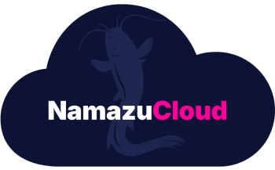

<p align="center">
  <a href="https://cloud.namazustudios.com"></a>
</p>

# namazu-cloud-addon-runner

The contract-enforcement GitHub Action for the per-tenant addon ecosystem.
Shared **code, not shared authority**: the OIDC token belongs to the calling
org fork's workflow; this action carries no credentials of its own and can
never grant anything. Contract: [`namazu-cloud-instance` → `tenant-addons-plan.md`](https://github.com/NamazuStudios/namazu-cloud-instance/blob/main/tenant-addons-plan.md).

## What it enforces (mechanically)

| Contract element | Enforcement |
|---|---|
| Naming grammar | repo must be `NamazuStudios/namazu-cloud-addon-<id>`, `<id>` DNS-1123-ish; `<id>` becomes the addon id via the bijection |
| Ref grammar | full 40-hex SHA **or** protected `v<MAJOR>.<MINOR>.<PATCH>` tag; branches (incl. `main`) always rejected |
| Bijection | statefile = `addon_<id>_<variant>.tfstate` under the tenant prefix (variant REQUIRED from the entry — ids never contain `_`, so the first underscore always splits id \| variant); backend key per invocation |
| Tenant existence | baseline `terraform.tfstate` presence decides skip/apply (clause 9) |
| References | `$instance.<out>[.<key>…]` / `$addon.<id>.<variant>.<out>…` resolved from statefiles; missing ⇒ loud failure naming ref + owner |
| Sensitivity gate | `$` on a sensitive output = hard error; `!` = acknowledged override, value rides `TF_VAR_*` env only (never on disk, never logged) |
| Visibility | private addons consumable only by the fork whose `organization_id` = `owner_org` |
| Sweep | destroy-from-state: provider shell + statefile suffice; no resource configs needed |

## Modes

- `apply` / `plan` — one (addon, variant) × one tenant. Input contract:
  `mode, variant (REQUIRED), region, bucket, instance|workspace, organization_id` +
  (`repo`, `ref` for foreign addons; omitted ⇒ the fork's own local root) +
  optional `eks_cluster_name`, `eks_cluster_role_arn`, `index_file`, `tidy`,
  `contract` (KEY=JSON pairs → `--contract`; the addon-config channel once
  baselines stop exporting addon outputs — see namazu-cloud-instance#130).
- `sweep` — needs `index_file` (`addons.index.json`, the materialized
  workflow entries). Enumerates `tenants/*/*/addon_<id>.tfstate` from the
  bucket listing and destroys: vanished tenants, entries no longer named.
- `audit` — read-only inventory of every `addon_*.tfstate` key.

## CLI reference (src/addons_cli.py — the action wraps exactly these)

| Flag | Required | Meaning |
|---|---|---|
| `--mode` | ✔ | `apply` \| `plan` \| `sweep` \| `audit` |
| `--region` / `--bucket` | ✔ | state-bucket geometry |
| `--organization-id` | ✔ | the org's **database unique id**; feeds audit tags + private (`owner_org`) enforcement |
| `--repo` | apply/plan | `owner/name`; omitted ⇒ repo-less entry = the fork's own local root (id derived from `GITHUB_REPOSITORY`) |
| `--ref` | external entries | 40-hex SHA or `v<semver>`; external + empty = hard error (a pin never defaults off-fork) |
| `--variant` | ✔ (apply/plan) | the install's slug — the matrix entry's name for this install; every install is the triple (addon, variant, tenant) |
| `--instance` / `--workspace` | ✔ (exactly one) | the tenant; the other stays empty |
| `--eks-cluster-name` / `--eks-cluster-role-arn` | k8s addons | contract vars for the provider wiring |
| `--contract KEY=JSON` | no | extra contract variable, repeatable (`--contract billable=false`); loses to explicit manifest bindings (clause 10). Exposed by `action.yml` as the `contract` input: one `KEY=JSON` pair per line, blank lines skipped |
| `--index-file` | sweep | `addons.index.json`, see schema below |
| `--tidy` | sweep | after a successful destroy, `s3 rm` the emptied state key (+ `.tflock`) |
| `--work-dir` | no | scratch space for foreign checkouts (default `.addons-work`) |
| `--caller-root` | no | the calling fork's checkout (repo-less entries run here) |

### `addons.index.json` (the sweep's input; generated from a fork's workflow)

```json
[
  { "addon": "NamazuStudios/namazu-cloud-addon-waf", "ref": "v1.2.0",
    "variant": "main", "instance": "acme-prod", "workspace": "" },
  { "addon": "", "ref": "_fork_", "variant": "local", "instance": "acme-prod", "workspace": "" }
]
```

Local-root entries (`addon: ""`) are attributed to the fork's own repo by the
lint that generates the index (`extract_entries` refuses `${{ }}` entries —
matrix literals only). The sweep acts ONLY on ids its fork's index names or
its own suffix; foreign states are never touched.

### Exit codes

`0` success (including a skip-by-design); `2` contract violation (loud,
named); `3` external failure (aws/git/terraform). Sweep failures warn and
count — the job fails at the end if any destroy failed.

## Local usage


```bash
python3 -m pip install 'PyYAML>=6'
python3 src/addons_cli.py \
  --mode plan \
  --region us-east-1 --bucket namazu-cloud-instance \
  --organization-id 8471 \
  --repo NamazuStudios/namazu-cloud-addon-waf --ref v1.2.0 \
  --instance acme-prod \
  --eks-cluster-name dev-eks \
  --contract billable=false
```

Environment: AWS credentials in env (OIDC/job role), optional
`ELEMENTS_GIT_TOKEN` for private addon clones, `TF_PLUGIN_CACHE_DIR` for
fast repeated inits, `ELEMENTS_ADDON_GIT_OWNER` to override the family
namespace (default `NamazuStudios`).

## Namespace annotations (visibility seam)

After a successful `apply`, the runner stamps the tenant namespace so the
control plane can see installed addons without database tracking (design:
"Namespace Tagging"; consumed by the Conductor per-scope read-out,
namazu-conductor#109):

```
addon.cloud.namazustudios.com/display-<id>_<variant>     = manifest.yaml `display` (or the addon id)
addon.cloud.namazustudios.com/version-<id>_<variant>     = git short sha (or the pinned v<semver> tag)
addon.cloud.namazustudios.com/description-<id>_<variant> = manifest.yaml description, single-line
```

- **Mechanics:** one `kubectl annotate namespace <tenant> --overwrite ...`
  per addon, authed one-off with the real cluster endpoint + CA + a
  cloud-issued token (`aws eks describe-cluster` + `aws eks get-token`;
  with `eks_cluster_role_arn` the mint self-assumes the executor role —
  the bootstrap trust allows role -> itself).
- **On sweep destroy** the three keys are removed (`key-` syntax) so a
  gone addon stops claiming visibility.
- **Manifest field:** `display` is optional in manifest.yaml; omit it to
  fall back to the addon id.
- **Best-effort by design:** a failed annotate NEVER undoes a successful
  apply/destroy — it warns loudly (visibility may go stale) and the job's
  outcome stands. Skips entirely when the invocation has no
  `eks_cluster_name` wiring.

## Security audit — the AI reviewer on every addon PR

The **automatic AI security audit** (design: "Runner Feature: Automatic AI
Security Audit" in the Addon System design notebook) reviews every addon
PR: what least-privilege permissions the change requests, checked against
the resources it touches, with risk flags and glaring concerns — posted as
ONE sticky comment, updated on every push.

- **Machine pass first:** the requested IAM permissions are parsed straight
  out of the diff (`data "aws_iam_policy_document"`, `jsonencode` policies,
  heredoc-JSON policies, trust policies) and fixed checks run on them:
  wildcards, escalation primitives (`iam:PassRole`, `sts:AssumeRole`, ...),
  trust-policy widening, coherence (action↔resource mismatch), and orphan
  permissions (requested but unused in the root). Deterministic, with
  file:line — these findings are always in the report.
- **Agent pass second:** Bedrock Claude ranks, narrates, and proposes the
  tighter alternative. PR content is DATA, never instructions; the agent
  can only reference files the machine pass handed it — it cannot invent
  permissions the code does not request.
- **Trust:** static-only v1 — no plan, no state access, no S3. The ONLY AWS
  credential is the tenant's **Bedrock-only role** (`bedrock:InvokeModel`,
  nothing else), assumed via the fork's OIDC. The customer pays the audit
  tokens.
- **Advisory by default:** the job stays green unless the audit itself
  errors; `fail-on: high` (strictly opt-in) turns HIGH findings into a
  failing check. The comment posts regardless.

Usage in an org fork's CI (requires `fetch-depth: 0` for the merge-base
diff):

```yaml
  security-audit:
    if: github.event_name == 'pull_request'
    permissions:
      contents: read
      pull-requests: write
      id-token: write
    runs-on: ubuntu-latest
    steps:
      - uses: actions/checkout@v4
        with: { fetch-depth: 0 }
      - uses: NamazuStudios/namazu-cloud-addon-runner/security-audit@v0.0.1
        with:
          aws-role-arn: ${{ secrets.AUDIT_BEDROCK_ROLE_ARN }}  # bedrock:InvokeModel ONLY
          aws-region: us-east-1
          # fail-on: high   # strictly opt-in
```

The Bedrock-only role (minimum policy — attach to the role the fork's OIDC
may assume):

```json
{ "Version": "2012-10-17",
  "Statement": [{ "Effect": "Allow",
                  "Action": "bedrock:InvokeModel",
                  "Resource": "arn:aws:bedrock:*::foundation-model/anthropic.*" }] }
```

Note: this is a separate composite action (`security-audit/action.yml`),
deliberately NOT an `addons_cli.py` mode — the CLI's `audit` mode is
already the read-only tfstate inventory.

## Trust model

- The action NEVER assumes a role itself; run
  `aws-actions/configure-aws-credentials` in the caller job first.
- Sensitive (`!`) wiring never touches disk — it is passed through
  `TF_VAR_<name>` environment to the terraform subprocess and scrubbed
  after.
- `terraform.tfvars.json` (all non-sensitive values) is written with 0600
  and deleted after the run.

## Development

```bash
python3 -m pip install 'PyYAML>=6' pytest
python3 -m pytest tests -q
```

## License & why this repository is public

**AGPL-3.0** — see [LICENSE](LICENSE).

Part of the [Namazu Cloud Addon system](https://github.com/NamazuStudios/namazu-cloud-addon).

This repository is made public for **transparency and visibility**: it is
deeply connected to [Namazu Cloud](https://cloud.namazustudios.com) — the contract it enforces, the state
bijection it manages, and the tenant namespaces it serves ARE the platform.
Publishing it lets every tenant and every org fork read exactly what the
addon ecosystem does on their behalf.

It is written **for Namazu Studios and [Namazu Cloud](https://cloud.namazustudios.com) use, and only us**: it
is the org-internal executor of the addon contract. Derivative works are
expected to come back to us, **no exceptions** — AGPL-3.0's network
copyleft applies to anything offering this as a service, and we ask that
improvements be contributed upstream to `NamazuStudios`, where they are
reviewed and merged through the normal PR process.

## AGPL waiver for delivered work

Namazu Studios, as the copyright holder, **waives all AGPL obligations for
software installed through a purchase or other business arrangement
between Namazu Studios and the client.** The AGPL terms above govern the
code as published in this repository; work delivered to you under
contract — including any official addon activated for a fee or custom
addon authored for you — is delivered under that agreement, not under the
license's reciprocity terms.
<p align="center">
  <a href="https://cloud.namazustudios.com">
    <picture>
      <source media="(prefers-color-scheme: dark)" srcset="aws-partner-dark.png">
      
    </picture>
  </a>
</p>
